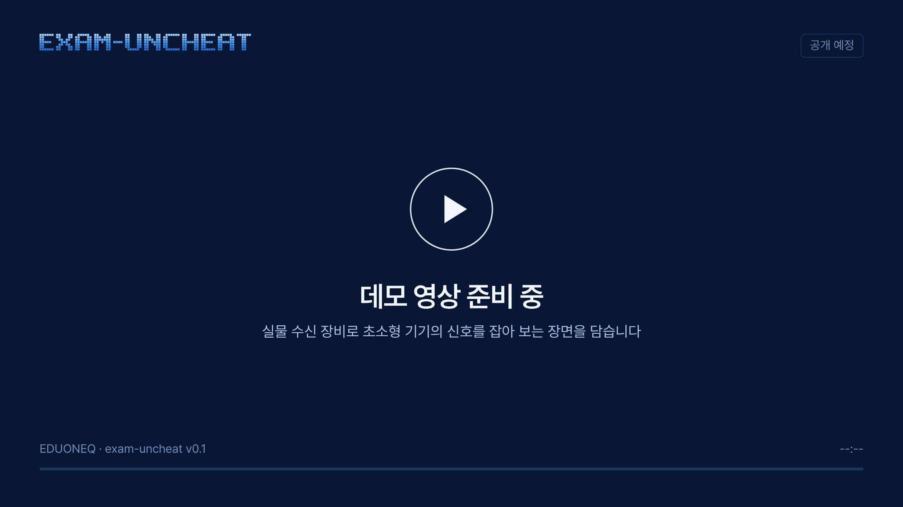
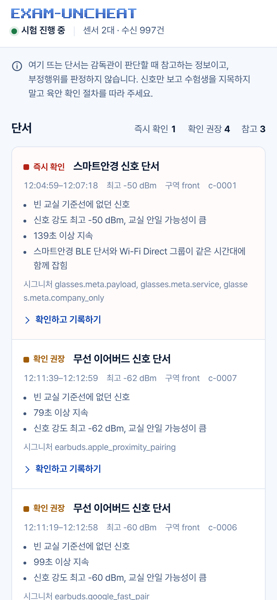
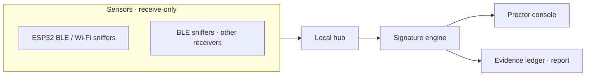

<p align="center">
  <picture>
    <source media="(prefers-color-scheme: dark)" srcset="docs/assets/banner-dark.png">
    
  </picture>
</p>

<p align="center">
  <a href="https://github.com/eduoneq/exam-uncheat/actions/workflows/ci.yml"></a>
  <a href="https://github.com/eduoneq/exam-uncheat/releases/tag/v0.1.0"></a>
  <a href="LICENSE"></a>
  <a href="LICENSE-CC-BY-4.0.txt"></a>
</p>

<p align="center">
  <a href="README.md">한국어</a> · <b>English</b> · <a href="https://github.com/eduoneq/exam-uncheat/releases">Releases</a> · <a href="docs/LIMITATIONS.md">Limitations (Korean)</a>
</p>

<br>

A wireless cheating device has to talk to something, and when it does, it leaves a trace. exam-uncheat picks up those traces and turns them into one proctor screen, one evidence log, and one report. It only listens. It never transmits, never jams, and never decides who cheated. It points out signals worth a look, and the proctor makes the call.

The same event format works for a cheap ESP32 board, a BLE sniffer, a monitor-mode Wi-Fi adapter, an SDR, or a commercial detector with serial output. With no hardware at all, the simulator walks you through the whole flow in about five minutes.

> [!IMPORTANT]
> v0.1 has only been tested against the simulator and replayed event streams. Real-world reception and false-positive rates have not been measured yet, so please read the [limitations](docs/LIMITATIONS.md) first. Do not install or bring equipment into an exam room without approval from the body running the exam.

## Demo video

<!--
  To swap in the video: point the <a href> below at the YouTube URL and replace the image
  with docs/assets/demo-video-thumb.png (16:9, 1280x720 or larger). For a GitHub-hosted mp4,
  paste the https://github.com/user-attachments/assets/... URL on its own line instead.
-->
<p align="center">
  <a href="https://github.com/eduoneq/exam-uncheat/blob/main/README.en.md#demo-video">
    
  </a>
</p>
<p align="center"><sub>We are filming real receivers picking up tiny devices and putting them on the console. Coming soon.</sub></p>

## Proctor console

<p align="center">
  
  &nbsp;
  
</p>
<p align="center"><sub>v0.1 with simulated data. The interface is in Korean. A clue is a prompt to check, not a verdict.</sub></p>

## How it works



Before students come in, the hub records what an empty room sounds like. During the exam it compares new BLE advertisements and Wi-Fi management frames against that baseline and an open signature database, and sorts what it finds into three levels: info, check, and urgent. Whatever the proctor confirms or dismisses goes into a hash-chained ledger, and the session closes with a report you can verify later with `exam-uncheat verify`.

Device addresses are pseudonymised with a per-session key before anything is written, and the key is thrown away when the session ends. Nothing is uploaded anywhere, and sessions are deleted after 30 days by default.

More detail (in Korean): [architecture](docs/ARCHITECTURE.md), [adapter spec](docs/ADAPTER_SPEC.md), [hardware](docs/HARDWARE.md), [legal notes](docs/LEGAL.md).

## Try it in five minutes

All you need is Python 3.10 or newer.

```bash
git clone https://github.com/eduoneq/exam-uncheat && cd exam-uncheat
python -m venv .venv && . .venv/bin/activate
pip install -e ".[dev]"

exam-uncheat demo --scenario all --decide
exam-uncheat verify data/sessions/*

exam-uncheat hub        # console at http://127.0.0.1:8765
```

Click **세션 시작** (start session) in the console, then feed it a recorded scenario from another terminal:

```bash
exam-uncheat replay scenarios/all.jsonl --speed 20
```

To use real sensors, run `exam-uncheat hub --serial /dev/ttyACM0:115200` with the firmware in `firmware/esp32-sniffer`. The firmware builds cleanly for ESP32-S3 and ESP32-C6 but has not been run on real boards yet.

## Hardware

Prices were checked on 2026-11-17 and will drift, so look at [HARDWARE.md](docs/HARDWARE.md) before you buy. Radios that could transmit are driven with receive-only commands.

| | Minimum | Recommended |
| --- | --- | --- |
| Parts | A laptop you already have, plus one or two ESP32-S3 or ESP32-C6 boards | Raspberry Pi 5 or a laptop, one or two ESP32-C5 boards, an MT7612U monitor-mode adapter |
| Rough cost per room | KRW 15,000–50,000 | KRW 350,000–500,000 with a Pi, 150,000–200,000 with a laptop |
| Sees | BLE advertising, 2.4 GHz Wi-Fi management frames | Everything on the left, plus 5 GHz, Wi-Fi Direct, and front/back signal strength |
| Misses | 5 GHz, classic Bluetooth, connected BLE, LTE/5G | Classic Bluetooth, connected BLE, LTE/5G content |

## Legal

This is not legal advice. Korea's Radio Waves Act (Art. 29) lists the cases where signal jammers may be used, and exam halls are not among them. That is why this project only listens. There is no blocking or transmit code in the repository, and CI rejects any that shows up. Listening passively and discarding data-frame payloads keeps the design on the cautious side of communications-secrecy rules, but any institution should get its own legal review before deploying.

## Roadmap

- A demo video recorded with real receivers
- Testing on actual ESP32-S3/C6 boards, an ESP32-C5 build, and lab measurements of hit and false-positive rates
- New adapters for Linux monitor-mode Wi-Fi, the nRF52840 BLE sniffer, and local MQTT
- Receive-only SDR band-energy sensing as an experiment
- Field trials in exam rooms, with the administering body's approval

## Contributing and license

Read [CONTRIBUTING.md](CONTRIBUTING.md) (Korean) first. The short version: no transmit code of any kind, and every signature needs a source URL. Report security issues privately as described in [SECURITY.md](SECURITY.md).

Code is licensed under [Apache-2.0](LICENSE). The signature database and documentation are under [CC BY 4.0](LICENSE-CC-BY-4.0.txt). See [NOTICE](NOTICE) for attributions. The Korean README is the canonical version.

<br>

<p align="center">
  <a href="https://github.com/eduoneq">
    <picture>
      <source media="(prefers-color-scheme: dark)" srcset="docs/assets/brand/eduoneq_logo_horizontal_white.svg">
      
    </picture>
  </a>
  <br>
  <sub>Built and maintained by EDUONEQ.</sub>
</p>
