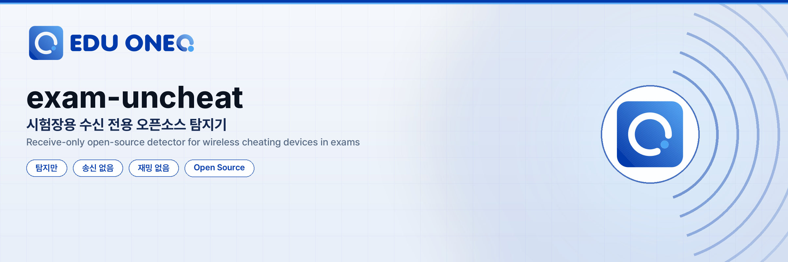
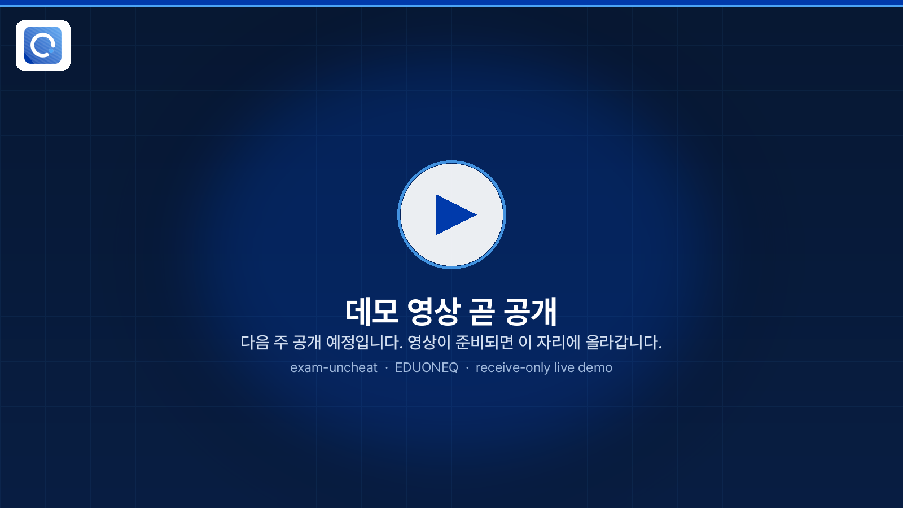
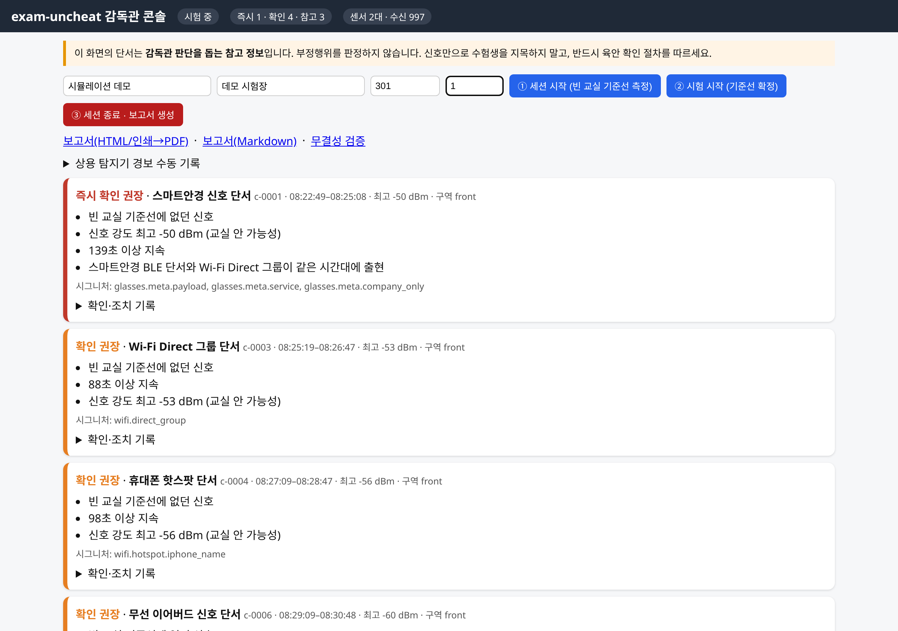
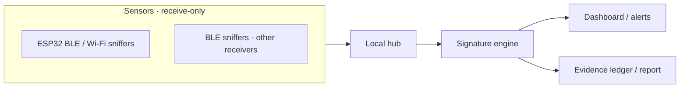

<p align="center">
  <picture>
    <source media="(prefers-color-scheme: dark)" srcset="docs/assets/banner-dark.png">
    
  </picture>
</p>

<h1 align="center">exam-uncheat</h1>

<p align="center">
  <strong>Receive-only open-source detector for wireless cheating devices in exams.</strong><br>
  Plug in any receive-only RF hardware; get one dashboard, one tamper-evident evidence log, and one incident report.<br>
  <strong>Detection only. No transmit. No jamming.</strong>
</p>

<p align="center">
  <a href="https://github.com/eduoneq/exam-uncheat/actions/workflows/ci.yml"></a>
  <a href="LICENSE"></a>
  <a href="LICENSE-CC-BY-4.0.txt"></a>
  <a href="CHANGELOG.md"></a>
</p>

<p align="center">
  <a href="README.md">한국어</a> · <a href="README.en.md">English</a>
  · Maintained by <strong>EDUONEQ</strong>
</p>

> [!IMPORTANT]
> v0.1 is validated with a **simulator and replayed event streams only** — not yet field-tested or hardware-tested. See [LIMITATIONS](docs/LIMITATIONS.md) (Korean).
> The project is **receive-only**: no transmitting, jamming, connecting, injecting, or decrypting. CI rejects such code. See [LEGAL](docs/LEGAL.md) (Korean).
> Do not install equipment in an exam room without the administering institution's approval.

**It is a decision-support tool for human proctors. It never decides that someone cheated.**

## In three seconds

- Any receive-only sensor can feed the same local hub: ESP32 sniffers, BLE sniffers, monitor-mode Wi-Fi, SDRs, commercial detectors with serial output, or a proctor's manual entry.
- The engine compares live public signals (BLE advertisements, Wi-Fi management frames) with an empty-room baseline and an open signature database, then raises *clues* (info / check / urgent).
- A hash-chained ledger and `exam-uncheat verify` protect the record. Addresses are pseudonymised; there is no cloud upload; sessions are deleted after 30 days by default.
- Korean radio law (전파법) does not list exam halls as an exception for jammers. This repository contains no transmit or jamming code.

## Demo video (coming soon)

<p align="center">
  
</p>

A live hardware demo video is planned for next week. When it is published, this section will be replaced with the recording.

<!--
DEMO_VIDEO: Replace the placeholder image in this section when the video is ready.
Example: [](https://www.youtube.com/watch?v=VIDEO_ID)
-->

## Proctor console



<p align="center"><sub>Proctor console (simulation data, v0.1). Clues are reference information, not a verdict.</sub></p>

## How it fits together



Details (Korean): [ARCHITECTURE](docs/ARCHITECTURE.md) · [ADAPTER_SPEC](docs/ADAPTER_SPEC.md) · [HARDWARE](docs/HARDWARE.md) · [LEGAL](docs/LEGAL.md) · [LIMITATIONS](docs/LIMITATIONS.md)

## Compared with existing tools

The table below describes typical, publicly visible traits. It is not a review or a critique of any one product.

| | Proctor phone app | Single-purpose detector | Online / seat-camera proctoring | **exam-uncheat** |
| --- | --- | --- | --- | --- |
| Hardware | One phone | One device family | Cameras | **Swappable** (ESP32–SDR–commercial) |
| Wi-Fi | Mostly AP lists | Product-specific | — | Probes, stations, P2P, 5 GHz (hardware-dependent) |
| Record | Limited | Product-specific | Video | **Hash-chained ledger + proctor actions + report** |
| Verdict | Varies | Product-specific | Vendor policy | **No verdict** (clues only) |
| Openness | Varies | Usually closed | Commercial | **Code, schemas, signatures, hardware notes** |

## Quick start (no hardware)

Python 3.10 or newer.

```bash
git clone https://github.com/eduoneq/exam-uncheat && cd exam-uncheat
python -m venv .venv && . .venv/bin/activate
pip install -e ".[dev]"

exam-uncheat demo --scenario all --decide
exam-uncheat verify data/sessions/*

exam-uncheat hub                                   # console at http://127.0.0.1:8765
```

In another terminal, click **Start session** in the console, then:

```bash
exam-uncheat replay scenarios/all.jsonl --speed 20
```

Real sensors: `exam-uncheat hub --serial /dev/ttyACM0:115200` (see `firmware/esp32-sniffer`). The ESP32 firmware has been **build-checked** for ESP32-S3 and ESP32-C6, not yet validated on hardware.

## Hardware tiers

Approximate costs as of 2026-11-17. Re-check [HARDWARE.md](docs/HARDWARE.md) before buying. Drivers use receive-only commands even on radios that could transmit.

| Tier | Kit | Approx. cost per room | Sees | Does not see |
| --- | --- | --- | --- | --- |
| **Minimum** | Existing laptop + 1–2× ESP32-S3 or ESP32-C6 | ~KRW 15,000–50,000 | Continuous BLE advertising, 2.4 GHz Wi-Fi management frames | 5 GHz, classic Bluetooth, connected BLE, LTE/5G |
| **Recommended** | Raspberry Pi 5 (or a laptop) + 1–2× ESP32-C5 + MT7612U monitor-mode adapter | ~KRW 350,000–500,000 with a Pi / ~KRW 150,000–200,000 if a laptop is reused | Minimum tier + **5 GHz**, Wi-Fi Direct, front/back RSSI | Classic Bluetooth, connected BLE, LTE/5G content |

v0.1 references: **minimum = ESP32-S3-DevKitC-1**, **recommended = ESP32-C5-DevKitC-1 + MT7612U**.

## Legal note

This is not legal advice. Under Korea's Radio Waves Act (전파법) Art. 29, exam halls are not listed among the exceptions that may use jamming equipment. This repository does not include blocking, disruption, or transmit code, and CI rejects such contributions. Receive-only operation and a no-payload design are intended to reduce risk under communications-secrecy rules, but an institution should obtain its own legal review before deployment. Room installation requires the administering body's prior approval.

## Roadmap

- **Next week:** live hardware demo video
- **Near term:** on-device validation for ESP32-S3/C6, ESP32-C5 build confirmation, lab measurement of detection and false-positive rates
- **Adapters:** Linux monitor-mode Wi-Fi, nRF52840 BLE sniffer, local MQTT ingest
- **Experimental:** SDR band-energy sensing (receive-only)
- **Field:** institution-approved exam-room trials

## Contributing and license

See [CONTRIBUTING.md](CONTRIBUTING.md) (Korean) for the **No-TX policy** and signature-submission rules (a source URL is required). Report security issues privately via [SECURITY.md](SECURITY.md).

- Code: [Apache-2.0](LICENSE)
- Signature database and documentation: [CC BY 4.0](LICENSE-CC-BY-4.0.txt)
- Notices: [NOTICE](NOTICE)

Maintained by **EDUONEQ**. Korean documentation is canonical: [README.md](README.md).
