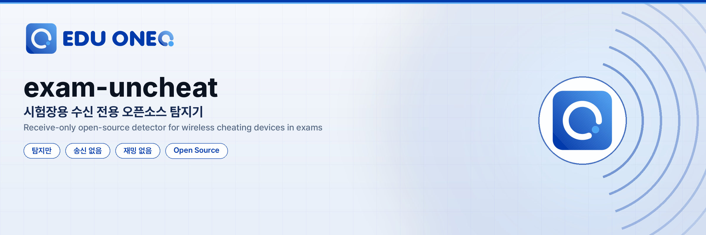
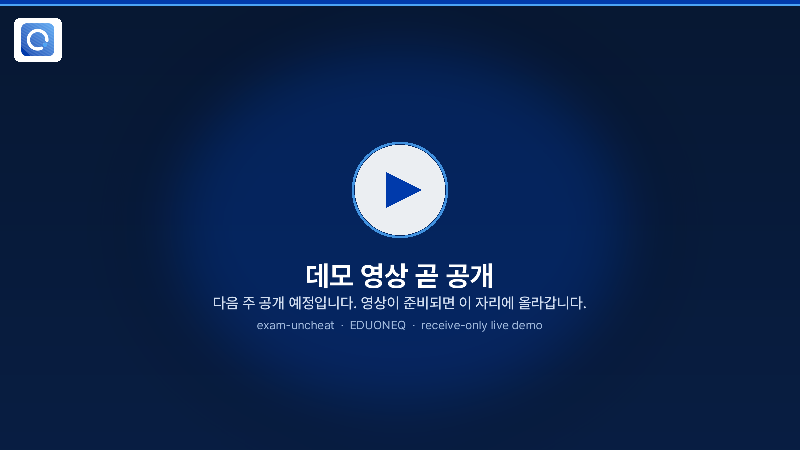
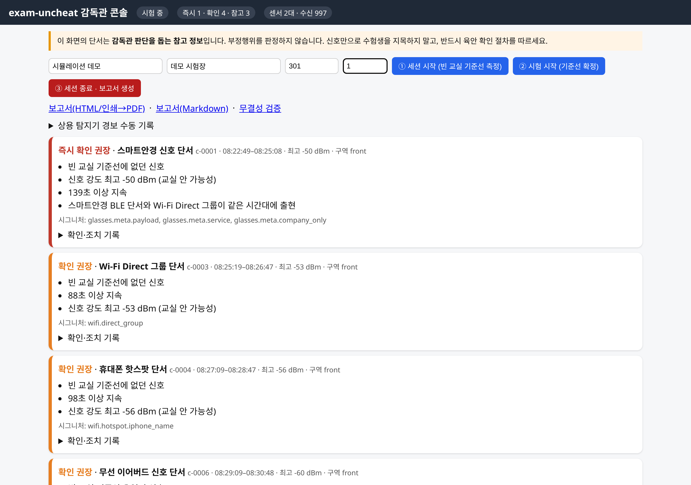
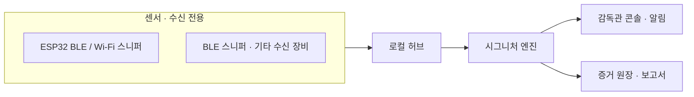

<p align="center">
  <picture>
    <source media="(prefers-color-scheme: dark)" srcset="docs/assets/banner-dark.png">
    
  </picture>
</p>

<h1 align="center">exam-uncheat</h1>

<p align="center">
  <strong>시험장용 수신 전용 오픈소스 탐지기</strong><br>
  무선 부정행위 기기가 통신하면 흔적이 남습니다. 그 흔적을 모아 감독관의 판단을 돕습니다.<br>
  <strong>탐지만 합니다. 송신 없음 · 재밍 없음.</strong>
</p>

<p align="center">
  <a href="https://github.com/eduoneq/exam-uncheat/actions/workflows/ci.yml"></a>
  <a href="LICENSE"></a>
  <a href="LICENSE-CC-BY-4.0.txt"></a>
  <a href="CHANGELOG.md"></a>
</p>

<p align="center">
  <a href="README.md">한국어</a> · <a href="README.en.md">English</a>
  · 유지: <strong>EDUONEQ</strong>
</p>

> [!IMPORTANT]
> **v0.1을 쓰기 전에**
> - 지금 버전은 **시뮬레이터와 리플레이로만** 검증했습니다. 실물 하드웨어와 시험장 현장 검증은 아직입니다. → [탐지 한계](docs/LIMITATIONS.md)
> - **수신만 합니다.** 전파를 보내거나, 막거나(재밍), 기기에 접속하거나, 통신 내용을 복호화하지 않습니다. 이런 코드는 CI가 거부합니다. → [법·개인정보](docs/LEGAL.md)
> - 시험 시행기관의 승인 없이 시험실에 장비를 설치·반입하지 마세요. 수능 고사장은 감독관도 전자기기 반입이 금지된다고 보도된 바 있습니다.

**바로 가기:** [3초 요약](#3초-요약) · [데모 영상](#데모-영상-곧-공개) · [감독관 콘솔](#감독관-콘솔) · [동작 방식](#동작-방식) · [빠른 시작](#5분-안에-돌려보기-하드웨어-없이) · [하드웨어](#하드웨어) · [법](#법운영-메모) · [English](README.en.md)

## 3초 요약

어떤 전파 **수신** 장비든 꽂으면, **하나의 화면 · 하나의 증거 기록 · 하나의 보고서**로 묶어 주는 허브입니다. 감독관의 판단을 돕는 도구이며, 부정행위를 판정하지 않습니다.

| 질문 | 답 |
| --- | --- |
| 무엇을 보나요? | BLE 광고, Wi-Fi 관리 프레임처럼 **공개된 신호**입니다. 빈 교실 기준선·공개 시그니처와 비교해 단서를 띄웁니다. |
| 무엇을 하지 않나요? | 송신, 재밍, 기기 접속, 통신 내용 복호화, 부정행위 **판정**은 하지 않습니다. 데이터는 교실 밖으로 나가지 않습니다. |
| 지금 쓸 수 있나요? | 하드웨어 없이 시뮬레이터로 바로 돌려볼 수 있습니다. 실제 시험장 도입은 현장 검증과 시행기관 승인이 필요합니다. |

## 데모 영상 (곧 공개)

<p align="center">
  
</p>

<p align="center">다음 주 공개 예정입니다. 실물 수신 장비로 초소형 기기의 신호가 콘솔에 단서로 뜨는 장면을 담을 예정입니다.</p>

<!--
DEMO_VIDEO: 다음 주 영상이 준비되면 이 섹션의 이미지와 문단을 아래로 교체하세요.
썸네일은 docs/assets/demo-soon.png 를 영상 썸네일로 바꿔도 됩니다.

교체 예시 (YouTube):

<p align="center">
  <a href="https://www.youtube.com/watch?v=VIDEO_ID">
    
  </a>
</p>

또는 GitHub가 지원하는 직접 업로드 영상:

https://github.com/user-attachments/assets/VIDEO_FILE
-->

## 감독관 콘솔



<p align="center"><sub>감독관 콘솔 화면 (시뮬레이션 데이터, v0.1). 단서는 참고 정보이며, 신호만으로 수험생을 지목하지 않습니다.</sub></p>

## 동작 방식



센서가 받은 공개 신호는 교실 안 허브로만 모입니다. 시그니처 엔진이 빈 교실 기준선과 비교해 단서(참고 / 확인 권장 / 즉시 확인 권장)를 만들고, 감독관이 확인·조치를 기록하면 해시 체인 원장과 보고서가 남습니다.

자세한 처리 순서와 세션 폴더 구조는 [ARCHITECTURE.md](docs/ARCHITECTURE.md)를 보세요. 센서 연결 규격은 [ADAPTER_SPEC.md](docs/ADAPTER_SPEC.md)입니다.

## 주요 기능

| 기능 | 설명 |
| --- | --- |
| 교체 가능한 센서 | 만 원대 ESP32, 라즈베리파이 + 모니터 모드 Wi-Fi, BLE 스니퍼, SDR, 시리얼 출력이 있는 상용 탐지기, 감독관의 수동 입력까지 같은 이벤트 규격으로 받습니다. |
| 폰 앱이 못 보는 신호 | 전용 수신기는 Wi-Fi 프로브 요청, 공유기에 붙은 단말, Wi-Fi Direct 그룹, 5 GHz, 연속 BLE 광고를 볼 수 있습니다. 장비별 차이는 [HARDWARE.md](docs/HARDWARE.md)를 보세요. |
| 공개 시그니처 DB | 블루투스 SIG 공식 등록부의 회사 ID·서비스 UUID와 공개 문헌을 출처와 함께 YAML로 관리합니다. ([signatures/](signatures/)) |
| 기준선 비교 | 수험생 입실 전 빈 교실을 먼저 측정하고, 시험 중에 새로 나타난 신호를 단서로 올립니다. |
| 사람이 판단 | 단서 → 감독관 확인(기기 확인함 / 오탐 / 추가 확인) → 보고서 초안. 도구가 부정행위 여부를 결정하지 않습니다. |
| 증거 사슬 | 모든 관측·단서·조치를 해시 체인 원장에 기록하고, `exam-uncheat verify`로 사후 위변조를 확인합니다. |
| 데이터는 교실 안에 | 기기 주소는 저장 전에 세션 키로 가명 처리하고, 세션이 끝나면 키를 폐기합니다. 클라우드 전송 기능이 없고, 기본 30일 후 자동 삭제합니다. |
| No-TX 정책 | 송신·재밍·주입·능동 스캔 코드는 `tools/no_tx_check.py`가 CI에서 거부합니다. |

## 다른 도구와의 차이

아래는 공개된 일반적인 특성을 정리한 것입니다. 특정 제품을 평가하거나 비난하려는 표가 아닙니다. 제품마다 버전과 설정에 따라 다를 수 있습니다.

| | 감독관 폰 앱 (예: 시중 BLE/Wi-Fi 스캔 앱) | 단일 전용 탐지기 | 온라인/좌석 카메라 감독 | **exam-uncheat** |
| --- | --- | --- | --- | --- |
| 하드웨어 | 폰 1대 | 전용기 1종 | 카메라 | **교체 가능** (ESP32 ~ SDR ~ 상용기) |
| Wi-Fi | 주로 AP 목록 | 제품별 | — | 프로브·단말·P2P·5 GHz (장비별) |
| 기록 | 제한적 | 제품별 | 영상 | **해시 체인 원장 + 감독관 조치 + 보고서** |
| 판정 | 앱마다 다름 | 제품별 | 상용 정책 | **판정하지 않음** (단서만 제공) |
| 공개 | 앱에 따라 다름 | 대체로 비공개 | 상용 | **코드 · 스키마 · 시그니처 · 하드웨어 사양** |

## 5분 안에 돌려보기 (하드웨어 없이)

Python 3.10 이상이 필요합니다.

```bash
git clone https://github.com/eduoneq/exam-uncheat && cd exam-uncheat
python -m venv .venv && . .venv/bin/activate
pip install -e ".[dev]"

# 1) 오프라인 데모: 빈 교실 → 스마트안경 → Wi-Fi Direct → 핫스팟 → 이어버드
exam-uncheat demo --scenario all --decide
exam-uncheat verify data/sessions/*

# 2) 허브 + 감독관 콘솔 (http://127.0.0.1:8765)
exam-uncheat hub
```

다른 터미널에서, 콘솔의 **① 세션 시작**을 누른 뒤 리플레이를 넣습니다. 시나리오 안에 시험 시작 신호가 있으면 **② 시험 시작**은 자동으로 넘어갑니다.

```bash
exam-uncheat replay scenarios/all.jsonl --speed 20
```

Windows에서는 가상환경 활성화가 `.venv\Scripts\activate` 입니다. 시리얼 포트 이름은 `COM3:115200` 형태를 쓰면 됩니다.

## 실제 센서 연결

```bash
# ESP32 (firmware/esp32-sniffer, USB 시리얼 NDJSON)
exam-uncheat hub --serial /dev/ttyACM0:115200 --serial /dev/ttyACM1:115200 --room 301
```

- 다른 장비는 [어댑터 규격](docs/ADAPTER_SPEC.md)대로 줄 단위 JSON을 시리얼·WebSocket(`/ws/ingest`)·HTTP(`POST /api/v1/events`)로 보내면 됩니다.
- 데이터 출력이 없는 상용 탐지기는 콘솔의 "상용 탐지기 경보 수동 기록"으로 같은 타임라인에 남깁니다.
- ESP32 펌웨어는 ESP32-S3·C6 대상으로 **빌드만** 확인했고, 실기기 동작 검증 전입니다.

## 하드웨어

가격은 2026-11-17 기준 대략치입니다. 구매 전에 [HARDWARE.md](docs/HARDWARE.md)에서 다시 확인하세요. 모든 장비는 **수신 전용으로만** 사용합니다.

| 티어 | 구성 | 교실당 대략 비용 | 보는 것 | 못 보는 것 |
| --- | --- | --- | --- | --- |
| **최소** | 기존 노트북(허브) + ESP32-S3 또는 ESP32-C6 보드 1~2개 | 약 1.5만~5만 원 | BLE 광고(연속), 2.4 GHz Wi-Fi 관리 프레임(프로브·비콘·P2P) | 5 GHz, 클래식 블루투스, 연결된 BLE 트래픽, LTE/5G |
| **권장** | 라즈베리파이 5(또는 노트북) + ESP32-C5 1~2개 + MT7612U 모니터 모드 USB 어댑터 | 약 35만~50만 원 (파이 포함) / 약 15만~20만 원 (노트북 재사용) | 최소 티어 + **5 GHz** 프로브·비콘·단말, Wi-Fi Direct, 교실 앞/뒤 RSSI 비교 | 클래식 블루투스, 연결된 BLE 트래픽, LTE/5G 내용 |

v0.1 레퍼런스는 **최소 = ESP32-S3-DevKitC-1**, **권장 = ESP32-C5-DevKitC-1 + MT7612U** 입니다. SDR·nRF52840 등 고급 구성은 [HARDWARE.md](docs/HARDWARE.md)의 실험 티어를 보세요.

## 법·운영 메모

- **재밍(전파 차단)은 하지 않습니다.** 전파법 제29조에 따라 시험장은 전파차단장치 사용 예외 목록에 없습니다. 인가 없이 차단 장치를 제조·수입·판매하면 처벌 대상이 될 수 있습니다.
- **수신만, 내용은 보지 않습니다.** BLE는 패시브 스캔, Wi-Fi는 무차별 수신만 합니다. 연결·주입·디인증이 없고, 데이터 프레임 페이로드는 저장하지 않습니다.
- **시험장 반입**은 시행기관의 사전 승인이 전제입니다.
- 이 안내는 공개 자료를 바탕으로 한 메모이며 **법률 자문이 아닙니다.** 기관이 도입하기 전에는 법률 검토를 받으세요.

자세한 조문과 개인정보 설계는 [LEGAL.md](docs/LEGAL.md)를 보세요.

## 로드맵

- **다음 주:** 실물 수신 장비 데모 영상
- **가까운 목표:** ESP32-S3/C6 실기기 검증, ESP32-C5 빌드 확인, 수신률·오탐·미탐의 실험실 측정
- **다음 어댑터:** Linux 모니터 모드 Wi-Fi, nRF52840 BLE 스니퍼, 로컬 MQTT 수신
- **실험:** SDR 대역 에너지 (수신 전용)
- **현장:** 시행기관 승인을 전제로 한 시험장 검증

이미 알려진 한계(연결된 기기, 전원 off, LTE/5G 전용, 위치 특정 불가 등)는 [LIMITATIONS.md](docs/LIMITATIONS.md)에 적어두었습니다.

## 기여

[CONTRIBUTING.md](CONTRIBUTING.md)를 먼저 읽어 주세요. 특히 **No-TX 정책**과 시그니처 제보 규칙(출처 URL 필수)을 지켜 주세요.

- 시그니처 제보: [이슈 템플릿](https://github.com/eduoneq/exam-uncheat/issues/new?template=signature.md)
- 오탐·미탐 제보: [이슈 템플릿](https://github.com/eduoneq/exam-uncheat/issues/new?template=false_positive.md)
- 보안 문제는 공개 이슈로 올리지 말고 [SECURITY.md](SECURITY.md)를 따라 주세요.

저장소 구성은 대략 다음과 같습니다.

```
src/exam_uncheat/   허브, 어댑터, 시그니처 엔진, 기준선 비교, 증거 원장, 보고서, 시뮬레이터
spec/               이벤트 · 시그니처 · 조치 JSON 스키마
signatures/         시그니처 DB (CC BY 4.0)
firmware/           ESP32 수신 전용 펌웨어 (S3·C6 빌드 확인, 실기기 미검증)
scenarios/          합성 시나리오 (무작위 로컬 주소만)
docs/               아키텍처, 어댑터 규격, 하드웨어, 법, 한계
ext/                법적 권한 기관용 확장 지점 — 문서만
tools/              no_tx_check, check_samples, rename
```

## 라이선스

- 코드: [Apache-2.0](LICENSE)
- 시그니처 DB·문서: [CC BY 4.0](LICENSE-CC-BY-4.0.txt)
- 자세한 고지: [NOTICE](NOTICE)

만든 곳: **EDUONEQ**

## English

exam-uncheat is a **receive-only**, open-source RF sensor hub for exam integrity. It collects public BLE advertisements and Wi-Fi management frames, compares them with an empty-room baseline and an open signature database, and shows *clues* that help a human proctor. It never transmits, jams, connects to a device, decrypts traffic, or decides that someone cheated.

A short English guide, including the same quick-start commands, is in [README.en.md](README.en.md).
