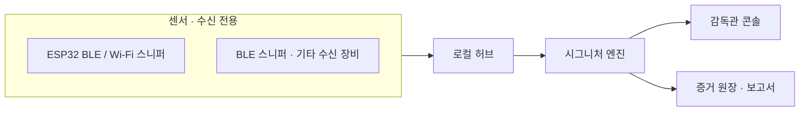
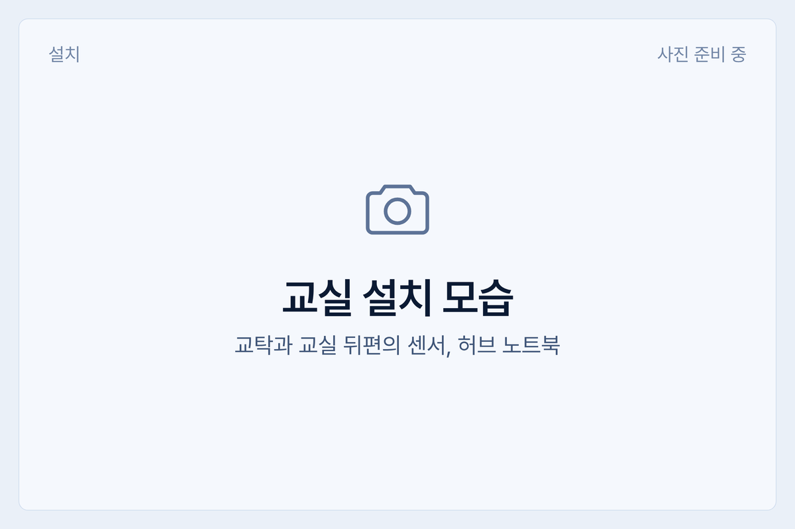
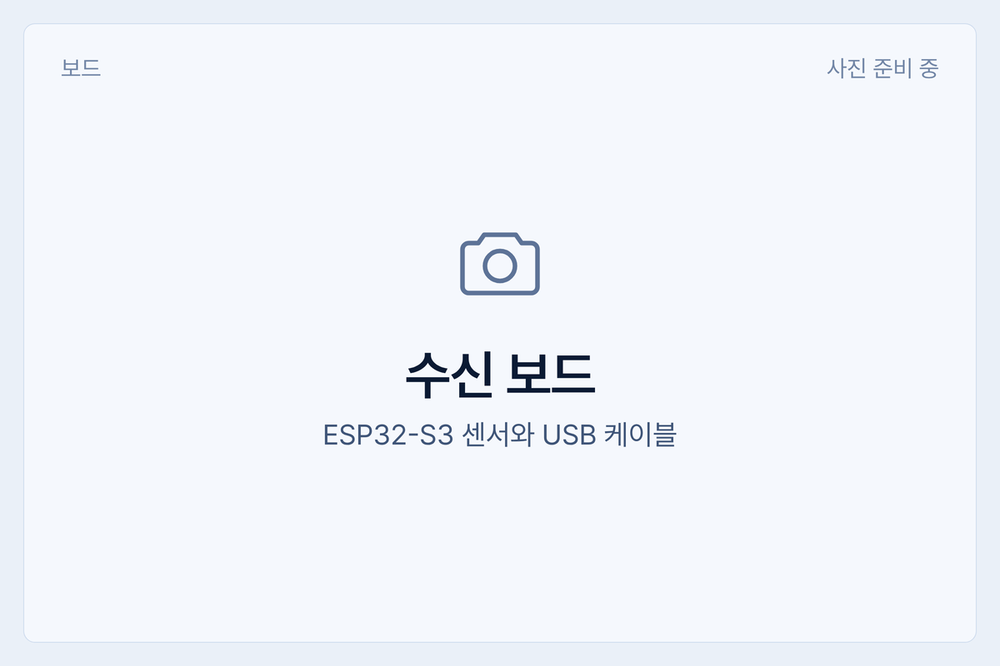
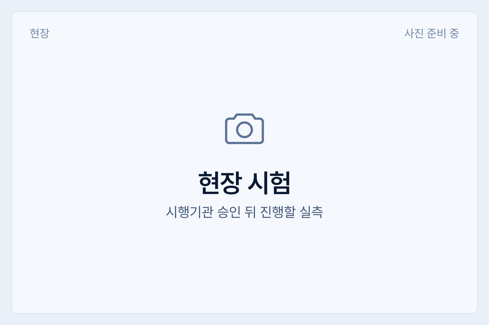

<p align="center">
  <picture>
    <source media="(prefers-color-scheme: dark)" srcset="docs/assets/banner-dark.png">
    
  </picture>
</p>

<p align="center">
  <a href="https://github.com/eduoneq/exam-uncheat/actions/workflows/ci.yml"></a>
  <a href="https://github.com/eduoneq/exam-uncheat/releases/tag/v0.1.0"></a>
  <a href="LICENSE"></a>
  <a href="LICENSE-CC-BY-4.0.txt"></a>
</p>

<p align="center">
  <b>한국어</b> · <a href="README.en.md">English</a> · <a href="https://github.com/eduoneq/exam-uncheat/releases">릴리스</a> · <a href="docs/LIMITATIONS.md">탐지 한계</a>
</p>

<br>

무선 부정행위 기기는 통신하는 순간 흔적을 남깁니다. exam-uncheat는 그 흔적을 받아서 감독관 화면 하나, 증거 기록 하나, 보고서 하나로 정리해 주는 오픈소스 허브입니다. 전파를 보내거나 막지 않고 듣기만 합니다. 어느 수험생이 부정행위를 했는지도 정하지 않습니다. 확인할 만한 신호를 보여 주고 판단은 감독관이 합니다.

만 원대 ESP32 보드부터 BLE 스니퍼, 모니터 모드 Wi-Fi 어댑터, SDR, 시리얼 출력이 있는 상용 탐지기까지 같은 규격으로 붙일 수 있습니다. 하드웨어가 없어도 시뮬레이터로 5분이면 전체 흐름을 볼 수 있습니다.

> [!IMPORTANT]
> v0.1은 시뮬레이터와 리플레이 데이터로만 검증했습니다. 실물 하드웨어 수신률과 시험장 오탐률은 아직 재지 않았으니 [탐지 한계](docs/LIMITATIONS.md)를 먼저 읽어 주세요. 시험 시행기관의 승인 없이 시험실에 장비를 설치하거나 들고 들어가면 안 됩니다. 수능 고사장은 감독관도 전자기기를 반입할 수 없다는 보도가 있었습니다.

## 데모 영상

<!--
  데모 영상 교체 방법
  1) 유튜브에 올렸다면: 아래  를 감싸는 <a href> 를 영상 주소로 바꾸고,
     썸네일을 docs/assets/demo-video-thumb.png (1280x720 이상, 16:9) 로 넣은 뒤 src 를 바꿉니다.
  2) GitHub에 직접 올린다면: 이슈나 PR 입력창에 mp4 를 끌어다 놓아 생긴
     https://github.com/user-attachments/assets/... 주소를 이 주석 바로 아래 줄에 그대로 붙입니다.
     (그 경우 아래 <p> 블록은 지웁니다.)
  3) 영상 아래 캡션의 "공개 예정" 문구를 실제 공개일로 바꿉니다.
-->
<p align="center">
  <a href="https://github.com/eduoneq/exam-uncheat#데모-영상">
    
  </a>
</p>
<p align="center"><sub>실물 수신 장비로 초소형 기기의 신호를 잡아 콘솔에 띄우는 장면을 찍고 있습니다. 공개 예정.</sub></p>

## 감독관 콘솔

교탁 노트북이나 태블릿에서 그대로 열리는 화면입니다. 왼쪽에서 세션을 시작하고 오른쪽에 뜨는 단서를 확인한 뒤 판단을 기록합니다. 휴대폰 폭에서는 단서 목록이 먼저 나옵니다.

<p align="center">
  
  &nbsp;
  
</p>
<p align="center"><sub>시뮬레이션 데이터로 찍은 v0.1 화면입니다. 단서는 참고 정보이고 신호만으로 수험생을 지목하지 않습니다.</sub></p>

## 동작 방식



센서가 받은 공개 신호는 교실 안 허브로만 모입니다. 수험생이 들어오기 전에 빈 교실을 먼저 재 두고 시험 중에 새로 나타난 신호를 그 기준선과 비교합니다. 시그니처 엔진은 결과를 참고, 확인 권장, 즉시 확인 권장 세 단계로 나눠 콘솔에 올립니다. 감독관이 확인한 내용과 조치는 해시 체인 원장에 쌓이고 세션이 끝나면 보고서로 묶입니다.

처리 순서와 세션 폴더 구조는 [ARCHITECTURE.md](docs/ARCHITECTURE.md)에, 센서 연결 규격은 [ADAPTER_SPEC.md](docs/ADAPTER_SPEC.md)에 있습니다.

## 할 수 있는 일

| | |
| --- | --- |
| 센서 교체 | ESP32, 라즈베리파이와 모니터 모드 Wi-Fi, BLE 스니퍼, SDR, 시리얼 출력이 있는 상용 탐지기를 같은 이벤트 규격으로 받습니다. 출력이 없는 탐지기는 감독관이 콘솔에서 직접 기록합니다. |
| 폰 앱보다 넓게 보기 | 전용 수신기는 Wi-Fi 프로브 요청, 공유기에 붙은 단말, Wi-Fi Direct 그룹, 5 GHz 대역, 끊기지 않는 BLE 광고까지 봅니다. 장비별 차이는 [HARDWARE.md](docs/HARDWARE.md)에 정리했습니다. |
| 공개 시그니처 | 블루투스 SIG 공식 등록부의 회사 ID와 서비스 UUID, 공개 문헌을 출처와 함께 [signatures/](signatures/)에 YAML로 둡니다. |
| 사람이 판단 | 단서마다 감독관이 기기 확인함, 오탐, 추가 확인 가운데 하나를 고르고 그대로 보고서 초안에 들어갑니다. |
| 증거 사슬 | 관측과 단서와 조치를 모두 해시 체인 원장에 남깁니다. 나중에 `exam-uncheat verify`로 고친 흔적이 없는지 확인할 수 있습니다. |
| 교실 밖으로 나가지 않는 데이터 | 기기 주소는 저장하기 전에 세션 키로 가명 처리하고 세션이 끝나면 키를 버립니다. 클라우드 전송 기능은 없고 기본 30일 뒤 자동으로 지웁니다. |
| 송신 코드 차단 | 송신, 재밍, 프레임 주입, 능동 스캔 코드가 들어오면 `tools/no_tx_check.py`가 CI에서 막습니다. |

## 다른 도구와 비교

공개된 일반적인 특성만 모았습니다. 특정 제품을 평가하려는 표가 아니고 제품마다 버전과 설정에 따라 다를 수 있습니다.

| | 감독관 폰 앱 | 단일 전용 탐지기 | 온라인·좌석 카메라 감독 | exam-uncheat |
| --- | --- | --- | --- | --- |
| 하드웨어 | 폰 1대 | 전용기 1종 | 카메라 | ESP32부터 SDR, 상용기까지 교체 |
| Wi-Fi | 주로 AP 목록 | 제품마다 다름 | 해당 없음 | 프로브, 단말, P2P, 5 GHz (장비에 따라) |
| 기록 | 제한적 | 제품마다 다름 | 영상 | 해시 체인 원장, 감독관 조치, 보고서 |
| 판정 | 앱마다 다름 | 제품마다 다름 | 업체 정책 | 판정하지 않고 단서만 보여 줌 |
| 공개 범위 | 앱마다 다름 | 대체로 비공개 | 상용 | 코드, 스키마, 시그니처, 하드웨어 사양 |

## 5분 안에 돌려보기

하드웨어 없이 Python 3.10 이상만 있으면 됩니다.

```bash
git clone https://github.com/eduoneq/exam-uncheat && cd exam-uncheat
python -m venv .venv && . .venv/bin/activate
pip install -e ".[dev]"

# 오프라인 데모: 빈 교실 → 스마트안경 → Wi-Fi Direct → 핫스팟 → 이어버드
exam-uncheat demo --scenario all --decide
exam-uncheat verify data/sessions/*

# 허브와 감독관 콘솔 (http://127.0.0.1:8765)
exam-uncheat hub
```

콘솔에서 **세션 시작**을 누르고, 다른 터미널에서 리플레이를 흘려 넣습니다. 시나리오에 시험 시작 신호가 들어 있어서 **시험 시작** 단계는 저절로 넘어갑니다.

```bash
exam-uncheat replay scenarios/all.jsonl --speed 20
```

Windows에서는 `.venv\Scripts\activate`로 가상환경을 켜고 시리얼 포트는 `COM3:115200`처럼 적습니다.

## 실제 센서 연결

```bash
# ESP32 (firmware/esp32-sniffer, USB 시리얼 NDJSON)
exam-uncheat hub --serial /dev/ttyACM0:115200 --serial /dev/ttyACM1:115200 --room 301
```

다른 장비는 [어댑터 규격](docs/ADAPTER_SPEC.md)에 맞춘 줄 단위 JSON을 시리얼, WebSocket(`/ws/ingest`), HTTP(`POST /api/v1/events`) 가운데 편한 쪽으로 보내면 됩니다. 데이터 출력이 없는 상용 탐지기는 콘솔의 "상용 탐지기 경보 직접 기록"으로 같은 타임라인에 남깁니다.

ESP32 펌웨어는 ESP32-S3와 C6 대상으로 빌드까지만 확인했습니다. 실기기 동작은 아직 검증하지 않았습니다.

## 하드웨어

가격은 2026년 11월 17일에 확인한 대략치라서 사기 전에 [HARDWARE.md](docs/HARDWARE.md)를 한 번 더 보세요. 송신이 가능한 장비도 수신 용도로만 씁니다.

| | 최소 구성 | 권장 구성 |
| --- | --- | --- |
| 장비 | 쓰던 노트북(허브)과 ESP32-S3 또는 ESP32-C6 보드 1~2개 | 라즈베리파이 5(또는 노트북), ESP32-C5 1~2개, MT7612U 모니터 모드 USB 어댑터 |
| 교실당 비용 | 1.5만~5만 원 | 파이 포함 35만~50만 원, 노트북을 쓰면 15만~20만 원 |
| 보는 신호 | 끊기지 않는 BLE 광고, 2.4 GHz Wi-Fi 관리 프레임(프로브·비콘·P2P) | 최소 구성에 더해 5 GHz 프로브·비콘·단말, Wi-Fi Direct, 교실 앞뒤 신호 세기 비교 |
| 못 보는 신호 | 5 GHz, 클래식 블루투스, 연결된 BLE 통신, LTE/5G | 클래식 블루투스, 연결된 BLE 통신, LTE/5G 내용 |

v0.1의 기준 보드는 최소 구성이 ESP32-S3-DevKitC-1, 권장 구성이 ESP32-C5-DevKitC-1과 MT7612U 어댑터입니다. SDR이나 nRF52840 같은 실험용 구성은 [HARDWARE.md](docs/HARDWARE.md)에 따로 적었습니다.

<!--
  하드웨어 사진 교체 방법
  아래 세 장은 자리 표시용 이미지입니다. 실제 사진을 찍으면 같은 폴더에 3:2 비율(예: 1800x1200)로 넣고 src 만 바꿉니다.
    docs/assets/photo-setup-placeholder.png  →  docs/img/photo-setup.jpg   교실 설치 모습
    docs/assets/photo-board-placeholder.png  →  docs/img/photo-board.jpg   수신 보드 근접 사진
    docs/assets/photo-field-placeholder.png  →  docs/img/photo-field.jpg   현장 시험 장면
  사진에 수험생 얼굴, 이름표, 수험번호가 보이지 않게 해 주세요. 올리기 전에 EXIF 위치 정보도 지웁니다.
-->
<table>
  <tr>
    <td width="33%" align="center"><br><sub>교실 설치</sub></td>
    <td width="33%" align="center"><br><sub>수신 보드</sub></td>
    <td width="33%" align="center"><br><sub>현장 시험</sub></td>
  </tr>
</table>

## 법과 운영

exam-uncheat는 전파를 막지 않습니다. 전파법 제29조는 전파차단장치를 쓸 수 있는 예외를 경호, 군사, 대테러, 공항, 원자력시설 방호 같은 경우로 한정하는데, 시험장은 이 목록에 없습니다. 인가 없이 차단 장치를 만들거나 수입하거나 팔면 처벌받을 수 있습니다.

듣는 방식도 좁게 잡았습니다. BLE는 패시브 스캔만 하고 Wi-Fi는 관리 프레임만 해석합니다. 기기에 접속하거나 프레임을 주입하거나 연결을 끊는 일은 하지 않고 데이터 프레임은 개수와 길이만 센 뒤 내용을 버립니다.

시험장에 들여놓으려면 시행기관의 사전 승인이 먼저입니다. 이 문단은 공개 자료를 바탕으로 쓴 메모일 뿐 법률 자문이 아니므로, 기관에서 도입할 때는 따로 법률 검토를 받아 주세요. 조문 출처와 개인정보 설계는 [LEGAL.md](docs/LEGAL.md)에 있습니다.

## 로드맵

- 데모 영상: 실물 수신 장비로 찍은 시연 공개
- 하드웨어 검증: ESP32-S3/C6 실기기 확인, ESP32-C5 빌드 확인, 수신률과 오탐·미탐 실험실 측정
- 어댑터 추가: Linux 모니터 모드 Wi-Fi, nRF52840 BLE 스니퍼, 로컬 MQTT 수신
- 실험: SDR 대역 에너지 측정 (수신 전용)
- 현장 시험: 시행기관 승인을 받은 뒤 실제 시험장에서 검증

연결된 기기, 꺼진 기기, LTE/5G 전용 기기, 위치 특정처럼 이미 알고 있는 한계는 [LIMITATIONS.md](docs/LIMITATIONS.md)에 모아 두었습니다.

## 기여

[CONTRIBUTING.md](CONTRIBUTING.md)를 먼저 읽어 주세요. 송신 코드를 받지 않는 No-TX 정책과, 시그니처를 제보할 때 출처 URL을 꼭 붙이는 규칙이 있습니다.

- [시그니처 제보](https://github.com/eduoneq/exam-uncheat/issues/new?template=signature.md)
- [오탐·미탐 제보](https://github.com/eduoneq/exam-uncheat/issues/new?template=false_positive.md)
- 보안 문제는 공개 이슈 대신 [SECURITY.md](SECURITY.md)의 비공개 경로로 알려 주세요.

```
src/exam_uncheat/   허브, 어댑터, 시그니처 엔진, 기준선 비교, 증거 원장, 보고서, 시뮬레이터
spec/               이벤트 · 시그니처 · 조치 JSON 스키마
signatures/         시그니처 DB (CC BY 4.0)
firmware/           ESP32 수신 전용 펌웨어 (S3·C6 빌드 확인, 실기기 미검증)
scenarios/          합성 시나리오 (무작위 로컬 주소만 사용)
docs/               아키텍처, 어댑터 규격, 하드웨어, 법, 한계
ext/                법적 권한이 있는 기관용 확장 지점 (문서만 있음)
tools/              no_tx_check, check_samples, rename
```

## 라이선스

코드는 [Apache-2.0](LICENSE), 시그니처 DB와 문서는 [CC BY 4.0](LICENSE-CC-BY-4.0.txt)입니다. 자세한 고지는 [NOTICE](NOTICE)에 있습니다.

<br>

<p align="center">
  <a href="https://github.com/eduoneq">
    <picture>
      <source media="(prefers-color-scheme: dark)" srcset="docs/assets/brand/eduoneq_logo_horizontal_white.svg">
      
    </picture>
  </a>
  <br>
  <sub>EDUONEQ가 만들고 관리합니다.</sub>
</p>
