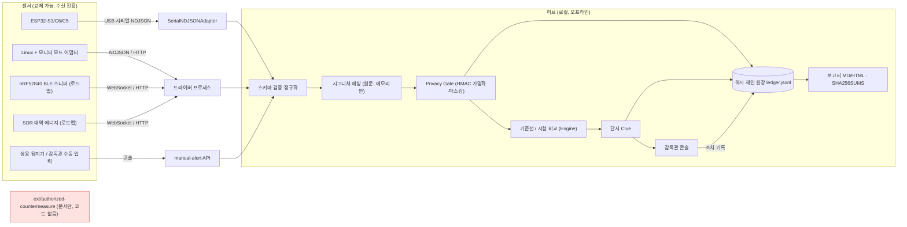

# exam-uncheat 아키텍처



## 처리 순서 (`Session.ingest`)
1. **검증** — `spec/event.schema.json` (draft 2020-12). 실패한 이벤트는 원장에 남기지 않고 거부 카운트만 올림
2. **정규화** — `event_id`, `ts`(허브 시각), UUID 소문자화, 제조사 데이터 32바이트로 자르기
3. **시그니처 매칭** — 원문 이름·SSID가 필요하므로 가명화 *전* 메모리 안에서만 수행
4. **Privacy Gate** — 주소 → `pid = HMAC-SHA256(session_key, addr)[:16]`, 전역 주소만 OUI 유지, SSID·기기 이름 마스킹
5. **원장 기록** — `{"seq","type","ts","data","prev","h"}`, `h = sha256(prev + canonical(seq,type,ts,data))`
6. **엔진** — 신호 묶음(group) 단위로 빈 교실 기준선과 비교
   - 묶음 키: 시그니처 일치 시 시그니처 ID(주소 순환에도 같은 묶음), 아니면 BLE 회사ID+서비스, AP는 SSID 가명 등
   - 새 묶음 또는 서로 다른 기기 수가 기준선보다 많으면 후보 → 20초 이상 지속(또는 high 시그니처 3회 이상)이면 단서
   - 점수 = 시그니처 가중치 (+10 강한 신호). 25 이상 확인 권장, 70 이상 즉시 확인 권장. 최고 RSSI가 -85 dBm보다 약하면 항상 "참고"
   - 조합 규칙: 스마트안경 BLE 단서와 Wi-Fi Direct 단서가 180초 안에 함께 나오면 "즉시 확인 권장"
   - 등급은 자동으로 내려가지 않음
7. **세션 종료** — 보고서 생성 → `SHA256SUMS` → 세션 키 폐기

## 세션 폴더
```
data/sessions/<날짜>_<시험장>_<고사실>_<교시>_<id>/
  manifest.json  ledger.jsonl  baseline.json  report.md  report.html  SHA256SUMS
```
