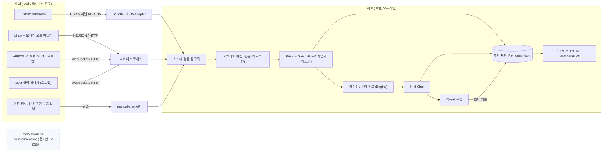

# exam-uncheat 아키텍처



## 이벤트 하나가 처리되는 순서 (`Session.ingest`)

1. `spec/event.schema.json`(draft 2020-12)으로 형식을 검사합니다. 통과하지 못한 이벤트는 원장에 남기지 않고 거부 횟수만 올립니다.
2. 형식을 맞춥니다. `event_id`와 허브 시각 `ts`를 붙이고 UUID를 소문자로 바꾸고, 제조사 데이터는 32바이트까지만 남깁니다.
3. 시그니처를 대조합니다. 기기 이름과 SSID 원문이 필요해서 가명 처리 전에 메모리 안에서만 합니다.
4. 가명 처리를 합니다. 주소는 `pid = HMAC-SHA256(session_key, addr)[:16]`으로 바꾸고, 전역 주소일 때만 OUI를 남깁니다. SSID와 기기 이름은 가립니다.
5. 원장에 씁니다. 한 줄은 `{"seq","type","ts","data","prev","h"}`이고 `h = sha256(prev + canonical(seq,type,ts,data))`입니다.
6. 엔진이 신호 묶음(group) 단위로 빈 교실 기준선과 비교합니다.
   - 시그니처가 맞으면 시그니처 ID로 묶습니다. 그래서 주소가 바뀌어도 같은 묶음으로 봅니다. 시그니처가 없으면 BLE 회사 ID와 서비스, AP는 SSID 가명 등으로 묶습니다.
   - 기준선에 없던 묶음이 나타나거나 서로 다른 기기 수가 기준선보다 많아지면 후보가 됩니다. 후보가 20초 이상 이어지거나 high 등급 시그니처가 3번 이상 잡히면 단서로 올립니다.
   - 점수는 시그니처 가중치에 강한 신호일 때 10점을 더한 값입니다. 25점부터 확인 권장, 70점부터 즉시 확인 권장이고 최고 RSSI가 -85 dBm보다 약하면 점수와 상관없이 참고로 둡니다.
   - 스마트안경 BLE 단서와 Wi-Fi Direct 단서가 180초 안에 함께 나오면 즉시 확인 권장으로 올립니다.
   - 한 번 올라간 등급은 저절로 내려가지 않습니다.
7. 세션을 닫으면 보고서를 만들고 `SHA256SUMS`를 쓴 뒤 세션 키를 폐기합니다.

## 세션 폴더
```
data/sessions/<날짜>_<시험장>_<고사실>_<교시>_<id>/
  manifest.json  ledger.jsonl  baseline.json  report.md  report.html  SHA256SUMS
```
